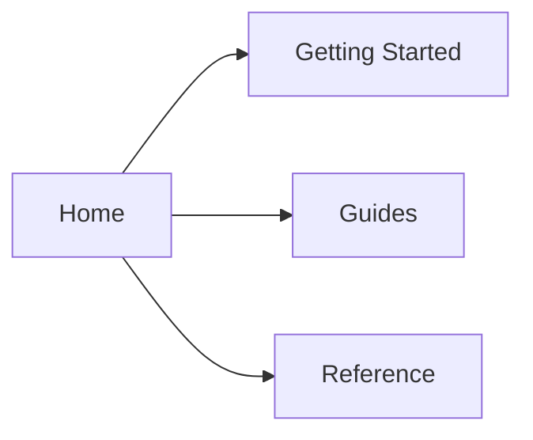

## Overview

Use this page to adapt your documentation site to your brand, your content structure, and the experience you want readers to have. This starter kit gives you a flexible base that you can tune for a simple homepage, a more editorial layout, or a product-focused knowledge base.

<Callout kind="info">

This is sample documentation meant to help you get started quickly. Replace the examples with your own content, imagery, and navigation structure.

</Callout>

## Theme settings

Your theme controls the visual tone of the site, including color, contrast, spacing, and the overall reading experience. For the brand shown in this starter kit, you can use `#a004fb` as a strong accent color for links, buttons, and highlights.

<Tabs>
  <Tab title="Light theme" icon="sun">

    Use a bright background, dark text, and a vivid accent color for calls to action. This works well when you want the documentation to feel open and easy to scan.

    ```json
    {
      "theme": "light",
      "accentColor": "#a004fb",
      "radius": "medium",
      "font": "Inter"
    }
    ```

  </Tab>
  <Tab title="Dark theme" icon="moon">

    Use a darker surface with softer borders and a slightly brighter accent color for emphasis. Keep code blocks readable and ensure links remain visible.

    ```json
    {
      "theme": "dark",
      "accentColor": "#c25bff",
      "radius": "medium",
      "font": "Inter"
    }
    ```

  </Tab>
  <Tab title="System theme" icon="settings">

    Follow the user's operating system preference and let them switch manually if needed. This gives readers control while keeping the design consistent.

    ```json
    {
      "theme": "system",
      "accentColor": "#a004fb",
      "enableThemeToggle": true
    }
    ```

  </Tab>
</Tabs>

## Branding options

Branding helps readers recognize your documentation instantly. Start with your logo, accent color, and a short tagline that reflects your voice. The slogan used in this starter kit is: `Share what you're into with the people who get you.`

<Columns cols={3}>
  <Card title="Logo" icon="book-open" href="#homepage-layout">

    Use a square or horizontal logo that remains readable at small sizes.

  </Card>
  <Card title="Color system" icon="zap" href="#theme-settings">

    Apply one primary accent and a small set of neutral surface colors.

  </Card>
  <Card title="Tone of voice" icon="users" href="#page-metadata">

    Write in a direct, friendly style that matches your audience.

  </Card>
</Columns>

## Homepage layout

Your homepage should answer three questions quickly: what this site is, where to start, and what readers can do next. Keep the top section short, then use cards or feature blocks to guide people toward the most useful pages.

<Steps>
  <Step title="Write a clear hero" icon="rocket">

    Open with a short summary, a supporting sentence, and one primary action.

  </Step>
  <Step title="Add navigation cards" icon="layout-grid">

    Group the most important pages into a simple grid so readers can move faster.

  </Step>
  <Step title="Keep the footer minimal" icon="chevron-right">

    Include secondary links, support details, and any legal text you need.

  </Step>
</Steps>

## Navigation customization

Navigation should reflect how your readers think, not how your team is organized internally. Use fewer top-level items when possible, and group related pages under clear labels such as Getting Started, Guides, and Reference.



### Example navigation config

Use a simple structure when you want the sidebar to stay easy to scan.

```json
{
  "navigation": [
    {
      "label": "Getting Started",
      "items": ["Introduction", "Quickstart"]
    },
    {
      "label": "Customization",
      "items": ["Theme", "Navigation", "Metadata"]
    },
    {
      "label": "Reference",
      "items": ["API", "Changelog"]
    }
  ]
}
```

<Expandable title="Advanced navigation tips" default-open="false">

Use nested sections only when you truly need them. If a menu becomes too deep, readers spend more time searching than learning. Keep the first level broad and the second level specific.

</Expandable>

## Page metadata

Metadata helps search engines, social previews, and documentation tools understand your pages. Keep titles short, descriptions specific, and labels consistent across the site.

<CodeGroup tabs="YAML,JSON">
  ```yaml
  title: Customization
  description: Adjust the look and feel of your documentation site to match your brand and content needs.
  sidebar_label: Customization
  ```

  ```json
  {
    "title": "Customization",
    "description": "Adjust the look and feel of your documentation site to match your brand and content needs.",
    "sidebar_label": "Customization"
  }
  ```
</CodeGroup>

| Field | Purpose | Recommendation |
|-------|---------|-----------------|
| `title` | Browser and page title | Keep it concise |
| `description` | Search and preview text | Use one clear sentence |
| `sidebar_label` | Sidebar navigation label | Use a short, recognizable name |
| `slug` | Page URL path | Keep it lowercase and readable |

## Recommended workflow

1. Choose your theme and accent color first.
2. Set the homepage layout before adding too many pages.
3. Organize navigation by user intent.
4. Review metadata before publishing.
5. Test the site on desktop and mobile.

<Callout kind="tip">

If you are customizing this starter kit for a real project, start with one page at a time. That makes it easier to keep the structure consistent as your content grows.

</Callout>